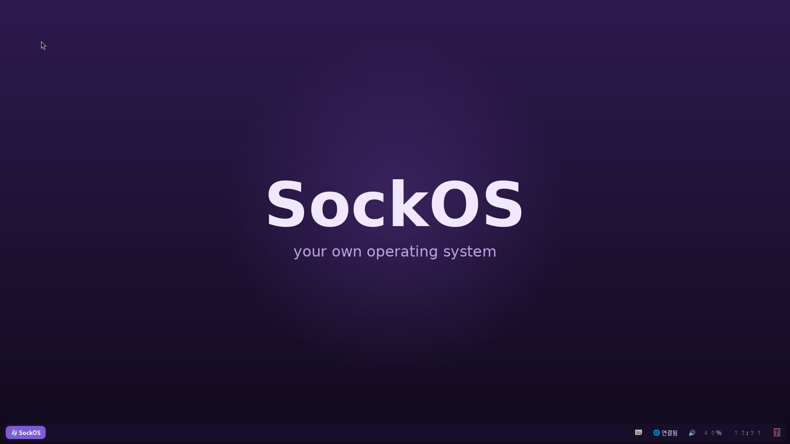
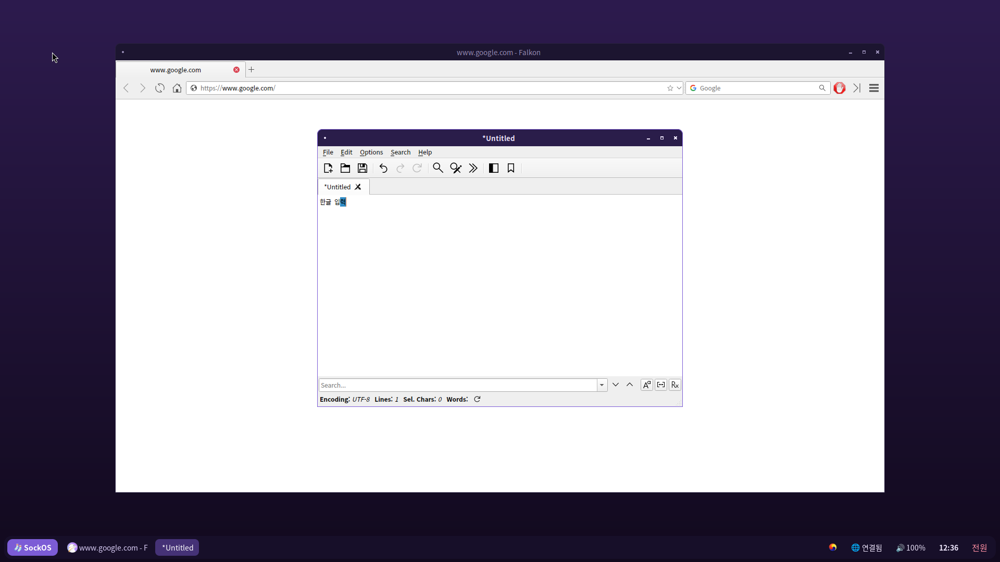
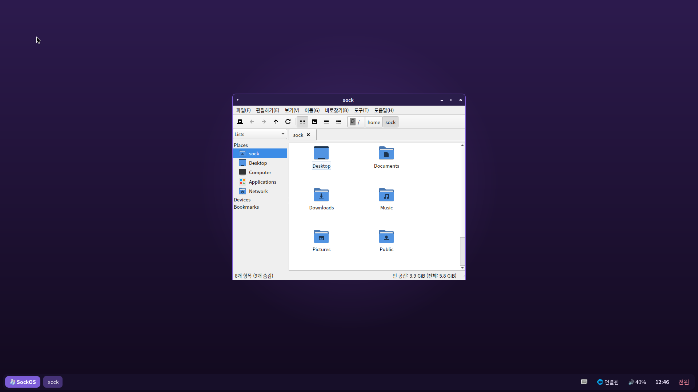

# SockOS



리눅스 커널 위에 직접 쌓아 올리는 나만의 OS예요. 지금은 QEMU 에뮬레이터에서 부팅해서 셸까지 뜨는 단계이고, 최종 목표는 이 OS 안에서 브라우저로 유튜브를 보는 거예요.

## 로드맵

- [x] 1단계: 저장소와 빌드 스크립트
- [x] 2단계: 리눅스 커널 + BusyBox로 부팅, OS 이름과 환영 화면, 셸, 네트워크(DHCP)
- [x] 3단계: 그래픽 데스크톱과 인터넷
- [x] 3.5단계: 작업 표시줄 데스크톱, 한글 입력, 기본 앱, 구글 검색
- [x] 4단계: 소리(PipeWire)와 영상 재생, 패널의 유튜브 바로가기

## 필요한 것 (Ubuntu / Debian 기준)

```sh
sudo apt install build-essential flex bison bc libelf-dev libssl-dev cpio xz-utils curl qemu-system-x86
```

Windows라면 WSL2(Ubuntu)에서, macOS라면 Linux 가상머신이나 Docker 안에서 빌드하는 걸 추천해요.

## 빌드하고 실행하기

```sh
make        # 커널과 BusyBox를 내려받아 빌드하고 initramfs를 만듭니다 (처음엔 10~20분)
make run    # 터미널 안에서 실행. 끄려면 poweroff 또는 Ctrl-A 다음 X
make gui    # QEMU 창을 띄워서 실행
```

결과물은 `out/bzImage`(커널)와 `out/initramfs.cpio.gz`(파일 시스템)예요.

## 그래픽 데스크톱 버전

```sh
sudo apt install debootstrap e2fsprogs
make kernel            # 커널 (데스크톱용 설정 포함)
sudo make desktop      # 데스크톱 디스크 이미지 out/sockos-desktop.img 만들기 (10~20분)
make run-desktop       # QEMU 창으로 실행
```

부팅하면 `sock` 사용자로 자동 로그인되고 SockOS 데스크톱이 떠요.

- 아래쪽 작업 표시줄: **SockOS** 버튼(또는 Windows 키)으로 앱 메뉴, 열린 창 목록, 네트워크, 볼륨(클릭하면 소리 설정), 시계, **전원** 버튼
- 바탕화면 오른쪽 클릭: 빠른 메뉴
- **한글 입력**: 한/영 키, 오른쪽 Alt, Shift+Space 중 아무거나로 전환
- 브라우저(Falkon): 시작 페이지와 기본 검색이 Google, 다운로드는 `Downloads` 폴더에 바로 저장
- 기본 앱: 파일 관리자(Windows+E), 터미널(Windows+Enter), 메모장, 사진 보기, PDF 보기
- 화면 캡처: PrintScreen 키 → `Pictures` 폴더


 소리는 PipeWire로 나오고, QEMU의 가상 사운드 카드를 거쳐 내 컴퓨터 스피커로 나와요. 소리 출력 방식은 `AUDIO=pipewire make run-desktop`처럼 바꿀 수 있어요.

KVM이 없는 환경(가상머신 안의 가상머신 등)에서는 많이 느려서 유튜브가 끊길 수 있어요. 리눅스 PC에서 KVM이 켜져 있으면 자동으로 빨라져요.

브라우저처럼 큰 프로그램은 라이브러리가 수백 개 필요해서, 데스크톱 버전의 프로그램들은 Ubuntu 패키지 저장소에서 가져와요. 커널, 부팅, 화면 구성, 브랜딩은 SockOS 것이에요. 넣을 프로그램은 `desktop/packages.txt`, 설정 파일은 `desktop/rootfs/`에서 바꿀 수 있어요.

- 창 관리와 단축키: `desktop/rootfs/etc/xdg/labwc/`
- 작업 표시줄 디자인: `desktop/rootfs/etc/xdg/waybar/`
- 앱 메뉴 디자인: `desktop/rootfs/etc/xdg/fuzzel/fuzzel.ini`
- 바탕화면 그림: `desktop/rootfs/usr/share/sockos/wallpaper.png`
- 세션 시작 스크립트: `desktop/rootfs/usr/local/bin/sockos-session`

## Windows에서 빠르게 실행하기 (WHPX 가속)

WSL 안에서는 CPU 가속(KVM)이 안 되는 PC가 있어요. 그럴 땐 QEMU를 Windows에서 직접 돌리면 빨라요.

1. 관리자 PowerShell에서 한 번만:
   ```
   Enable-WindowsOptionalFeature -Online -FeatureName HypervisorPlatform -All
   winget install SoftwareFreedomConservancy.QEMU
   ```
   그리고 재부팅
2. Ubuntu(WSL)에서: `cd ~/OS-develop && make export-windows`
3. PowerShell에서: `powershell -ExecutionPolicy Bypass -File $env:USERPROFILE\SockOS\run-sockos.ps1`

노트북이 뜨거워지거나 갑자기 꺼지면 충전기를 꽂고 가볍게 실행하세요: `... run-sockos.ps1 -Cpus 2 -Width 1280 -Height 720`

## 내 마음대로 바꾸기

- OS 이름, 버전, 호스트 이름: `config.sh`
- 환영 화면: `rootfs/etc/motd`
- 부팅 때 실행되는 일: `rootfs/etc/init.d/rcS`
- 커널 기능: `kernel/myos.config`

`rootfs/` 폴더에 넣은 파일은 그대로 OS 안에 들어가요. `@OS_NAME@`, `@OS_VERSION@`, `@OS_HOSTNAME@`은 빌드할 때 `config.sh` 값으로 바뀝니다.

## 구조

```
config.sh               설정
kernel/myos.config      커널 설정 조각 (defconfig 위에 덮어씀)
rootfs/                 OS 안에 들어갈 파일들 (init, /etc ...)
scripts/build-kernel.sh 커널 다운로드와 빌드
scripts/build-busybox.sh BusyBox(셸과 기본 명령어) 빌드
scripts/build-rootfs.sh initramfs 만들기
scripts/run.sh          QEMU 실행
scripts/build-desktop.sh 데스크톱 디스크 이미지 만들기
scripts/run-desktop.sh  데스크톱 QEMU 실행
desktop/                데스크톱 패키지 목록과 설정 파일
```

부팅 순서는 커널 → `/init`(파일 시스템 연결) → BusyBox init → `/etc/init.d/rcS`(호스트 이름, 네트워크) → 셸이에요.
